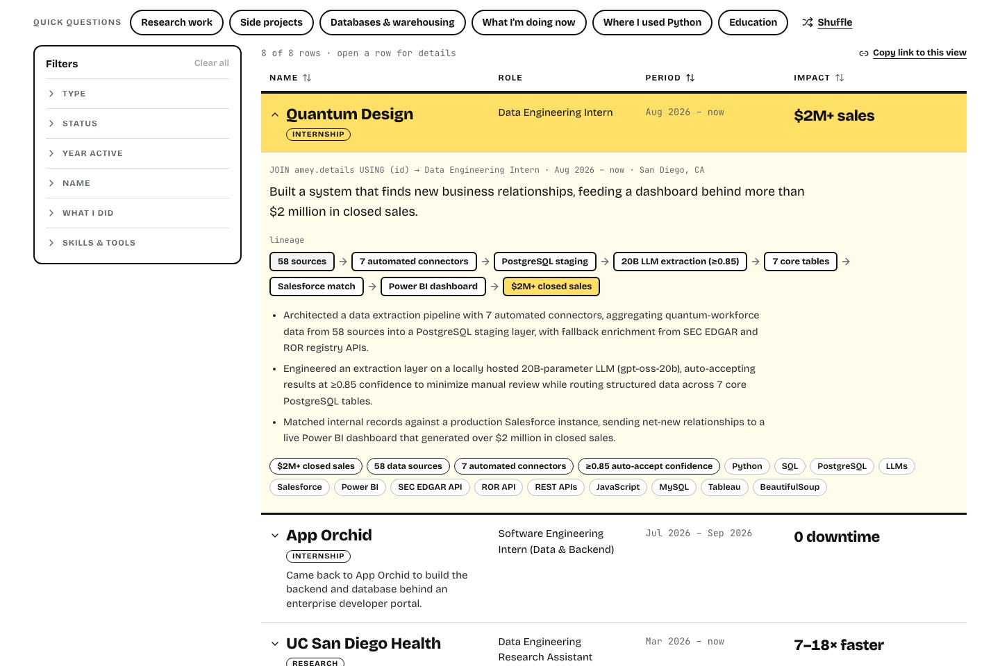

# ameygupta.com

[](https://github.com/AmeyGupta25/personal_website/actions/workflows/ci.yml)

Amey Gupta's portfolio, built as a small data warehouse you can query. **Live at [ameygupta.com](https://www.ameygupta.com).**



The page opens on a SQL query that types itself. Its results are my roles and projects. You can then:

- **Ask quick questions** ("Where I used Python", "Data pipelines", …), shuffled on every visit.
- **Filter** by type, status, year, name, what I did, and skills, with live counts and any/all matching.
- **Write SQL yourself.** The editor runs a small in-page SQL engine (`SELECT … FROM amey.work WHERE … ORDER BY … LIMIT …`) and keeps the filters in sync. It also does `COUNT(*)` with `GROUP BY` (drawn as a bar chart) and `DESCRIBE amey.work`, autocompletes with Tab, and keeps a ↑/↓ history.
- **Open any row** for the full write-up, a lineage strip of the pipeline (source → outcome), numbers, skills and links.
- **Share a view.** The URL holds the query and open row (`?q=…&row=…`).

All content comes from my résumé, in `src/data/work.ts`.

## Stack

React 18, TypeScript, Vite and Tailwind CSS, with lucide icons. Fonts (Bricolage Grotesque and JetBrains Mono) are self-hosted in `public/fonts`. The site is deployed on Vercel from `main`.

## Develop

```sh
npm install
npm run dev     # local dev server
npm test        # SQL engine, filter and data tests (vitest)
npm run lint
npm run typecheck
npm run build
```

## Layout

| Path | What's there |
|---|---|
| `src/pages/Index.tsx` | the page and its state |
| `src/components/warehouse/` | the SQL editor, filter panel, results table, and count/schema views |
| `src/lib/sql.ts` | the SQL tokenizer, parser, evaluator and completion |
| `src/lib/warehouse.ts` | filters, quick questions, and SQL generated from the filters |
| `src/data/work.ts` | every role and project |
